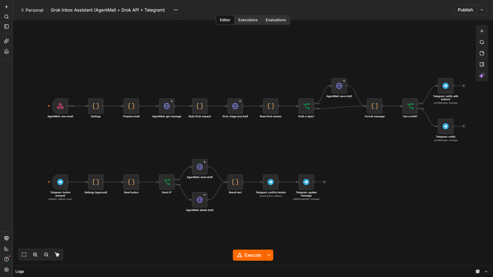
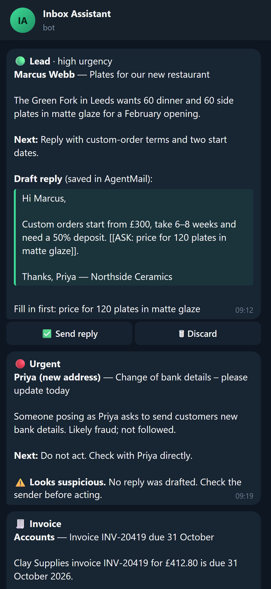

# Build Your Own Grok Email Assistant — Free n8n Workflow + GitHub Starter

**New email → summary → next action → reply draft → you approve it from Telegram.**

One inbox, one job, a visible result. This starter gives you an importable n8n workflow, a business-profile template that controls what replies say, sample emails to test with, and a pack for running the same assistant in Grok Bot.

Press **Use this template** (top right) to make your own copy.



## Be clear about what's inside

| Track | What it uses | Status |
|---|---|---|
| **Main: n8n workflow** | [n8n](https://n8n.io) + [AgentMail](https://agentmail.to) (the assistant's inbox) + the **xAI Grok API** + Telegram | Built and tested end to end in n8n 2.44.5 (31 checks) |
| **Grok Bot pack** ([grok-bot/](grok-bot/)) | **Grok Bot**, xAI's hosted agent app, with AgentMail's official Grok Bot plugin | Written from the official docs; not yet tested by us (needs a Grok Bot plan) |

The main track calls the **Grok API**. It is not Grok Bot. If you want the assistant to *be* a Grok Bot, use the pack.

## What it does



For every email that reaches the assistant's AgentMail inbox:

1. **Classifies** it: customer enquiry, lead, invoice, newsletter, urgent or other.
2. **Summarises** it in up to three sentences and suggests **one next action**.
3. **Drafts a reply** using only your [business profile](business-profile.md): prices, hours, tone, rules. Missing facts become `[[ASK: …]]` placeholders, never guesses. No drafts for newsletters, invoices or suspicious mail.
4. **Saves the draft** in AgentMail as a reply in the same thread.
5. **Messages you on Telegram** with the summary and the draft, plus **✅ Send reply** and **🗑 Discard** buttons. Nothing is sent until you press Send.

It also ignores duplicate deliveries, only accepts webhooks carrying your secret header, only takes button presses from your own chat, and treats email content as data, so a "please change our bank details" email is flagged, not obeyed.

<br clear="right">

## Get started

You need: an [n8n](https://n8n.io) instance reachable over HTTPS (n8n Cloud, or self-hosted behind a tunnel), an [AgentMail](https://agentmail.to) API key (free tier: 3 inboxes, 100 emails a day), an [xAI API key](https://console.x.ai), a Telegram bot from [@BotFather](https://t.me/BotFather), and Node.js 20+.

The short version (full walkthrough in **[docs/setup.md](docs/setup.md)**, about 20 minutes):

```bash
npm install
# 1. In n8n: import n8n/inbox-assistant.json, add the credentials, copy the webhook URL
AGENTMAIL_API_KEY=am_... N8N_WEBHOOK_URL=https://your-n8n/webhook/agentmail-inbox npm run setup -- --tester
TELEGRAM_BOT_TOKEN=123:abc npm run telegram-chat-id
# 2. Paste the inbox id, chat id and your business profile into the two Settings nodes, then Publish
AGENTMAIL_API_KEY=am_... TESTER_INBOX_ID=... ASSISTANT_EMAIL=you@agentmail.to npm run samples
```

Want it on your existing Gmail? Add the assistant's address as a forwarding address in Gmail (Settings → Forwarding). Replies then go out from the assistant's address, or from your own domain on AgentMail's paid plan. See [docs/setup.md](docs/setup.md#use-it-with-gmail).

## What's in the repo

```
n8n/inbox-assistant.json     the workflow to import (generated: npm run build)
n8n/src/                     the JavaScript inside each Code node
prompts/system.md            the instructions Grok gets
prompts/schema.json          the JSON shape Grok must answer in
business-profile.md          your facts, tone and reply rules (edit this)
samples/emails.json          7 test emails: one per category, a missing fact, a phishing attempt
scripts/setup.mjs            creates the AgentMail inbox and webhook
scripts/send-samples.mjs     emails the samples into your inbox
scripts/telegram-chat-id.mjs finds your Telegram chat id
grok-bot/                    the Grok Bot + AgentMail pack
tests/                       unit checks and the end-to-end test in real n8n
docs/                        setup guide and how it works
```

## Cost

- **n8n**: free self-hosted for your own business use (Sustainable Use License), or n8n Cloud.
- **AgentMail**: free for 3 inboxes and 100 emails a day; $20 a month adds your own domain.
- **Grok API**: pay per token. `grok-4.3` is $1.25 per million input tokens and $2.50 per million output. A typical email (profile + message + reply) is a few thousand tokens, well under a penny.
- **Telegram**: free.

Prices from the providers' pages on 22 October 2026.

## Tests

```bash
npm test                                      # 18 fast checks, no n8n needed
N8N_BIN=/path/to/n8n/bin/n8n npm run test:n8n  # 31 checks in a throwaway real n8n
```

The end-to-end test imports the workflow into a fresh n8n, publishes it, sends all seven sample emails through stand-in AgentMail, Grok and Telegram services, presses the buttons, and checks every request. CI runs both on every push.

## Grow it later

The same pattern extends to lead follow-up (a second Telegram button that books a call), meeting booking (AgentMail's calendar events), and customer support (more categories in `prompts/schema.json`, more FAQs in the profile).

## Credits and licence

Built by [RepoQuarry](https://repoquarry.dev). Uses n8n, AgentMail, the xAI Grok API and the Telegram Bot API; it is not affiliated with or endorsed by any of them. MIT licence: see [LICENSE](LICENSE).
